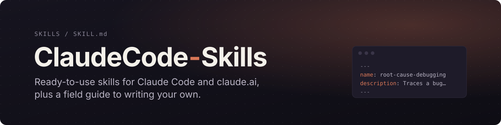
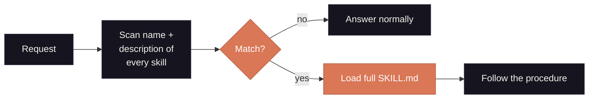

<p align="center">
  
</p>

<p align="center">
  <a href="#skills"></a>
  <a href=".github/workflows/validate-skills.yml"></a>
  <a href="LICENSE"></a>
  <a href="CONTRIBUTING.md"></a>
</p>

<p align="center">
  <a href="#install"><b>Install</b></a>
  &nbsp;&middot;&nbsp;
  <a href="#skills"><b>Skills</b></a>
  &nbsp;&middot;&nbsp;
  <a href="#how-skills-work"><b>How skills work</b></a>
  &nbsp;&middot;&nbsp;
  <a href="#write-your-own"><b>Write your own</b></a>
  &nbsp;&middot;&nbsp;
  <a href="#community-picks"><b>Community picks</b></a>
</p>

<br>

A **skill** is a folder with a `SKILL.md` file: a short, focused procedure Claude loads only when a
request needs it. Every skill here is complete — workflow, anti-patterns, and a worked example —
follows one [template](templates/SKILL_TEMPLATE.md), and is checked in CI by
[`validate_skills.py`](scripts/validate_skills.py).

<br>

## Install

```bash
git clone --depth 1 https://github.com/deepaksharma0801/ClaudeCode-Skills.git ~/ClaudeCode-Skills
mkdir -p ~/.claude/skills
```

```bash
# one skill
cp -R ~/ClaudeCode-Skills/skills/development/root-cause-debugging ~/.claude/skills/

# every skill
for d in ~/ClaudeCode-Skills/skills/*/*/; do cp -R "${d%/}" ~/.claude/skills/; done
```

| Location | Path | Available in |
|:--|:--|:--|
| Personal | `~/.claude/skills/<name>/SKILL.md` | Every project on your machine |
| Project | `.claude/skills/<name>/SKILL.md` | Anyone who clones that repo |
| claude.ai | Zip the skill folder and upload it in Skills settings | Your claude.ai account |

No build step and no registry. Claude picks the skill up on the next session.

<br>

## Skills

### Development

| Skill | What it does |
|:--|:--|
| [`root-cause-debugging`](skills/development/root-cause-debugging/SKILL.md) | Traces a bug backward to the line that first created the bad state, and fixes it there |
| [`safe-refactor`](skills/development/safe-refactor/SKILL.md) | Pins behavior with tests, then refactors in small steps with the suite green after each |
| [`codebase-onboarding`](skills/development/codebase-onboarding/SKILL.md) | Maps a new repo: entry points, one traced request, architecture, and how to run it |
| [`commit-message-writer`](skills/development/commit-message-writer/SKILL.md) | Writes a commit message from the staged diff in the repo's existing style |
| [`pr-description-writer`](skills/development/pr-description-writer/SKILL.md) | Writes a PR title and description — summary, changes, risk, testing — from the real diff |
| [`dockerfile-optimizer`](skills/development/dockerfile-optimizer/SKILL.md) | Rewrites a Dockerfile for cached builds, multi-stage size savings, and a non-root user |
| [`regex-builder`](skills/development/regex-builder/SKILL.md) | Builds a regex from a description and proves it against passing and failing cases |
| [`api-design-review`](skills/development/api-design-review/SKILL.md) | Reviews an API design for naming, status codes, errors, pagination, and breaking changes |
| [`performance-investigation`](skills/development/performance-investigation/SKILL.md) | Measures first, profiles the hot path, and proves each speedup with before/after numbers |
| [`db-migration-safety`](skills/development/db-migration-safety/SKILL.md) | Lints Postgres migrations for locks and breaking changes and rewrites them as safe steps. Ships `scripts/lint_migration.py` |
| [`ci-failure-debugger`](skills/development/ci-failure-debugger/SKILL.md) | Finds the first real error in a failing CI run, classifies it, and fixes the cause |
| [`dependency-upgrade-planner`](skills/development/dependency-upgrade-planner/SKILL.md) | Plans major-version upgrades from changelogs and codemods, one verified step at a time |
| [`observability-instrumentation`](skills/development/observability-instrumentation/SKILL.md) | Adds structured logs, RED metrics, and OpenTelemetry traces that answer incident questions |
| [`git-recovery`](skills/development/git-recovery/SKILL.md) | Recovers lost commits, branches, and stashes from the reflog without overwriting more work |
| [`implementation-plan-writer`](skills/development/implementation-plan-writer/SKILL.md) | Turns a spec into small, ordered, verifiable tasks built from the real codebase |
| [`readme-writer`](skills/development/readme-writer/SKILL.md) | Writes a README from the real code: a one-line pitch, a quickstart that runs, usage, and config |
| [`feature-flag-rollout`](skills/development/feature-flag-rollout/SKILL.md) | Ships behind a flag in stages with go/kill criteria, a tested kill switch, and a cleanup date |

### Data & Analysis

| Skill | What it does |
|:--|:--|
| [`csv-data-summarizer`](skills/data-and-analysis/csv-data-summarizer/SKILL.md) | Profiles a CSV for types, distributions, nulls, and correlations in one pass |
| [`sql-query-reviewer`](skills/data-and-analysis/sql-query-reviewer/SKILL.md) | Catches join fan-out, NULL traps, and date-filter bugs, then flags slow patterns |
| [`metric-definition-writer`](skills/data-and-analysis/metric-definition-writer/SKILL.md) | Turns a vague KPI into a precise definition with edge cases and reference SQL |
| [`ab-test-readout`](skills/data-and-analysis/ab-test-readout/SKILL.md) | Checks the experiment, computes lift with confidence intervals, and makes a ship call |
| [`log-triage`](skills/data-and-analysis/log-triage/SKILL.md) | Groups log lines into patterns, ranks them by count and onset, and finds the likely cause |
| [`data-quality-checks`](skills/data-and-analysis/data-quality-checks/SKILL.md) | Designs freshness, volume, uniqueness, and integrity tests for a table or pipeline |
| [`chart-critique`](skills/data-and-analysis/chart-critique/SKILL.md) | Catches misleading scales and wrong chart types, then proposes a clearer redesign |
| [`cohort-retention-analysis`](skills/data-and-analysis/cohort-retention-analysis/SKILL.md) | Builds cohort retention tables without fake drop-off from unfinished periods. Ships `scripts/retention.py` |
| [`funnel-analysis`](skills/data-and-analysis/funnel-analysis/SKILL.md) | Ordered funnels with conversion windows, the biggest leak, and the segment where it is worst |
| [`dataset-anonymizer`](skills/data-and-analysis/dataset-anonymizer/SKILL.md) | Hashes, generalizes, and redacts a dataset before sharing, then checks k-anonymity. Ships `scripts/anonymize.py` |
| [`survey-analysis`](skills/data-and-analysis/survey-analysis/SKILL.md) | Reports survey results with margins of error, honest comparisons, and coded free text |
| [`metric-drop-investigation`](skills/data-and-analysis/metric-drop-investigation/SKILL.md) | Explains a metric move: checks the data, sizes the change, decomposes by segment, and matches it to events |
| [`experiment-design`](skills/data-and-analysis/experiment-design/SKILL.md) | Designs an A/B test before launch: one metric, guardrails, sample size, duration, and a decision rule |
| [`sql-from-question`](skills/data-and-analysis/sql-from-question/SKILL.md) | Turns a question into correct SQL by confirming grain and join keys, then cross-checks the number |
| [`dashboard-spec-writer`](skills/data-and-analysis/dashboard-spec-writer/SKILL.md) | Specs a dashboard from the decisions it supports: defined metrics, comparisons, layout, and alerts |

### Security & QA

| Skill | What it does |
|:--|:--|
| [`secrets-precommit-check`](skills/security-and-qa/secrets-precommit-check/SKILL.md) | Blocks commits that contain keys, tokens, private keys, or `.env` files |
| [`auth-code-review`](skills/security-and-qa/auth-code-review/SKILL.md) | Reviews login, sessions, tokens, and permission checks for broken access control |
| [`threat-model-lite`](skills/security-and-qa/threat-model-lite/SKILL.md) | One-page STRIDE model with trust boundaries, ranked threats, and concrete mitigations |
| [`dependency-audit`](skills/security-and-qa/dependency-audit/SKILL.md) | Runs the right audit tool per ecosystem and ranks fixes with exact upgrade commands |
| [`test-plan-writer`](skills/security-and-qa/test-plan-writer/SKILL.md) | Risk-based test plan with level and priority per case, then writes the must-haves |
| [`accessibility-audit`](skills/security-and-qa/accessibility-audit/SKILL.md) | Audits a page against WCAG 2.2 AA with located issues and code fixes |
| [`flaky-test-investigator`](skills/security-and-qa/flaky-test-investigator/SKILL.md) | Reproduces an intermittent test failure, classifies the cause, and makes it deterministic |
| [`privacy-data-review`](skills/security-and-qa/privacy-data-review/SKILL.md) | Traces personal data through a change and flags leaks, over-collection, and missing deletion |
| [`security-headers-check`](skills/security-and-qa/security-headers-check/SKILL.md) | Grades security headers and cookies, then writes the config that fixes them. Ships `scripts/check_headers.py` |
| [`security-finding-triage`](skills/security-and-qa/security-finding-triage/SKILL.md) | Traces scanner findings from source to sink to separate real bugs from false positives |
| [`iam-policy-review`](skills/security-and-qa/iam-policy-review/SKILL.md) | Finds wildcards and escalation paths in AWS IAM policies and rewrites them least-privilege. Ships `scripts/iam_lint.py` |
| [`leaked-secret-response`](skills/security-and-qa/leaked-secret-response/SKILL.md) | Responds to an exposed key in the right order: rotate, check for abuse, clean up, prevent |
| [`injection-review`](skills/security-and-qa/injection-review/SKILL.md) | Traces untrusted input to SQL, shell, template, HTML, URL, and file sinks and fixes them structurally |
| [`e2e-test-writer`](skills/security-and-qa/e2e-test-writer/SKILL.md) | Writes stable Playwright tests for critical flows with role locators and per-test data |
| [`file-upload-review`](skills/security-and-qa/file-upload-review/SKILL.md) | Reviews uploads end to end: type by content, server-side names, private storage, safe serving |
| [`load-test-planner`](skills/security-and-qa/load-test-planner/SKILL.md) | Plans k6 load tests from real traffic with SLO thresholds, then names the bottleneck |

### Business & Communication

| Skill | What it does |
|:--|:--|
| [`weekly-status-update`](skills/business-and-comms/weekly-status-update/SKILL.md) | Turns git history or notes into an outcome-first update with blockers |
| [`meeting-notes-to-actions`](skills/business-and-comms/meeting-notes-to-actions/SKILL.md) | Pulls decisions, owned and dated action items, and open questions from a transcript |
| [`incident-postmortem`](skills/business-and-comms/incident-postmortem/SKILL.md) | Writes a blameless postmortem with impact, timeline, root cause, and owned actions |
| [`release-notes-writer`](skills/business-and-comms/release-notes-writer/SKILL.md) | Turns commits and PRs into user-facing release notes, breaking changes first |
| [`design-doc-writer`](skills/business-and-comms/design-doc-writer/SKILL.md) | Writes a design doc with goals, non-goals, alternatives, risks, and a rollout plan |
| [`decision-memo`](skills/business-and-comms/decision-memo/SKILL.md) | Frames a choice, compares options on agreed criteria, and leads with a recommendation |
| [`explain-for-stakeholders`](skills/business-and-comms/explain-for-stakeholders/SKILL.md) | Rewrites technical updates for non-engineers, with the bottom line first and a clear ask |
| [`code-review-comments`](skills/business-and-comms/code-review-comments/SKILL.md) | Writes labeled, kind, actionable review comments so authors know what blocks the merge |
| [`customer-support-reply`](skills/business-and-comms/customer-support-reply/SKILL.md) | Drafts support replies that answer first, give clear steps, and never overpromise |
| [`technical-blog-post`](skills/business-and-comms/technical-blog-post/SKILL.md) | Writes engineering posts built on a real problem, real numbers, runnable code, and trade-offs |
| [`runbook-writer`](skills/business-and-comms/runbook-writer/SKILL.md) | Writes on-call runbooks with branching triage, exact commands, rollback, and escalation |
| [`job-description-writer`](skills/business-and-comms/job-description-writer/SKILL.md) | Writes job postings with the real work, few must-haves, the pay range, and the hiring process |
| [`interview-scorecard-writer`](skills/business-and-comms/interview-scorecard-writer/SKILL.md) | Builds structured interview kits with behavioral anchors and writes evidence-based feedback |
| [`okr-writer`](skills/business-and-comms/okr-writer/SKILL.md) | Writes OKRs with outcome objectives, baseline-to-target key results, and separate initiatives |

<br>

## How skills work

Claude does not read every skill on every turn. It scans each skill's `name` and `description`,
and loads the full `SKILL.md` only for the one that matches.



So the `description` decides whether a skill ever runs. A great procedure behind a vague
description is dead weight.

<details>
<summary><b>Skills, MCP servers, and plugins — which one do you need?</b></summary>
<br>

| | Skills | MCP servers | Plugins |
|:--|:--|:--|:--|
| **Answers** | *How* should Claude do this? | *What* can Claude reach? | *Where* does Claude run? |
| **Format** | `SKILL.md` + frontmatter | A running process (stdio / HTTP) | CLI package |
| **Gives you** | Procedure, standards, judgment | Data, APIs, side effects | Commands, hooks, bundled tools |
| **Loads** | On demand | At session start | At install |

Reach for a **skill** when Claude *can* do the task but does it inconsistently. Reach for an
**MCP server** when Claude cannot see the thing you are talking about.

</details>

<br>

## Write your own

Copy [`templates/SKILL_TEMPLATE.md`](templates/SKILL_TEMPLATE.md) to
`skills/<category>/<your-skill>/SKILL.md` and fill in every section:

```markdown
---
name: your-skill                # lowercase + hyphens, same as the folder
description: What it does, and exactly when Claude should use it. Max 200 characters.
compatibility: Requires Python 3.8+ with pandas.   # optional
---

# Detailed Instructions        # the one or two rules that matter most
## Overview                     # the problem this skill fixes
## Workflow Rules               # numbered, imperative steps
## Anti-Patterns (What NOT to do)
## Examples                     # a real request and the exact expected output
```

**The description is the trigger.** Say what the skill does *and* when to use it:

| | Description |
|:--|:--|
| **Weak** | `A powerful skill for working with data.` |
| **Weak** | `Data analysis helper.` |
| **Strong** | `Profiles a CSV for column types, distributions, missing data, and correlations. Use when a user shares a tabular file or asks for a data profile.` |

**Anti-patterns are load-bearing.** Listing the mistakes Claude makes without the skill changes
behavior more than adding more instructions.

**Bundle what can be automated.** Put repeatable checks in `scripts/`, long reference material in
`references/`, and realistic test prompts in `evals/evals.json`, so `SKILL.md` stays under 500
lines. Frontmatter follows the [Agent Skills specification](https://agentskills.io/specification);
see [CONTRIBUTING.md](CONTRIBUTING.md#frontmatter-rules) for every allowed field.

Check your work before opening a PR:

```bash
python3 scripts/validate_skills.py
```

<br>

## Community picks

Skills and collections maintained elsewhere, each under its own license.

<details>
<summary><b>Skills</b></summary>
<br>

| Skill | Source | What it does |
|:--|:--|:--|
| [web-artifacts-builder](https://github.com/anthropics/skills/tree/main/skills/web-artifacts-builder) | anthropics/skills | Multi-component claude.ai artifacts with React, Tailwind, and shadcn/ui |
| [mcp-builder](https://github.com/anthropics/skills/tree/main/skills/mcp-builder) | anthropics/skills | Guided workflow for building MCP servers around external APIs |
| [brand-guidelines](https://github.com/anthropics/skills/tree/main/skills/brand-guidelines) | anthropics/skills | Applies brand colors, fonts, and typography to artifacts |
| [internal-comms](https://github.com/anthropics/skills/tree/main/skills/internal-comms) | anthropics/skills | Newsletters, status reports, and FAQs in a house format |
| [systematic-debugging](https://github.com/obra/superpowers/tree/main/skills/systematic-debugging) | obra/superpowers | Four-phase debugging, including backward root-cause tracing |
| [test-fixing](https://github.com/mhattingpete/claude-skills-marketplace/tree/main/engineering-workflow-plugin/skills/test-fixing) | mhattingpete | Finds failing tests and proposes fixes |
| [ios-simulator-skill](https://github.com/conorluddy/ios-simulator-skill) | conorluddy | Drives the iOS Simulator through accessibility APIs |

</details>

<details>
<summary><b>Collections</b></summary>
<br>

| Repository | Worth a look for |
|:--|:--|
| [anthropics/skills](https://github.com/anthropics/skills) | The official spec, document skills (`docx`, `pdf`, `pptx`, `xlsx`), and reference examples |
| [ComposioHQ/awesome-claude-skills](https://github.com/ComposioHQ/awesome-claude-skills) | A large directory of practical skills and app integrations |
| [travisvn/awesome-claude-skills](https://github.com/travisvn/awesome-claude-skills) | Clear notes on progressive disclosure and vetting skills before use |
| [GetBindu/awesome-claude-code-and-skills](https://github.com/GetBindu/awesome-claude-code-and-skills) | Hundreds of skills, persona skills, and expert agents |
| [ai-for-developers/awesome-claude](https://github.com/ai-for-developers/awesome-claude) | SDKs, agent frameworks, and prompt architecture beyond skills |

</details>

<details>
<summary><b>MCP servers</b></summary>
<br>

| Server | Capability | Notes |
|:--|:--|:--|
| [`server-postgres`](https://github.com/modelcontextprotocol/servers) | Read-only SQL and schema inspection | A safe default for pointing an agent at production |
| [`server-memory`](https://github.com/modelcontextprotocol/servers) | Knowledge-graph memory | State that survives across sessions |
| [`server-github`](https://github.com/modelcontextprotocol/servers) | Repos, issues, pull requests | Official integration |
| [`exa-mcp-server`](https://github.com/exa-labs/exa-mcp-server) | Real-time web search | Needs `EXA_API_KEY` |

An MCP server runs with whatever credentials you give it: scope database users, prefer read-only,
and keep keys in environment variables, never in a committed config. More in
[`mcp-servers/`](mcp-servers) and [win4r/Awesome-Claude-MCP-Servers](https://github.com/win4r/Awesome-Claude-MCP-Servers).

</details>

<br>

## Repository layout

```text
ClaudeCode-Skills/
├── skills/
│   ├── development/            17 skills
│   ├── data-and-analysis/      15 skills
│   ├── security-and-qa/        16 skills
│   └── business-and-comms/     14 skills
├── templates/SKILL_TEMPLATE.md
├── scripts/validate_skills.py  runs in CI on every PR
├── mcp-servers/                MCP config examples
├── claude-code-plugins/        plugin notes
└── assets/                     README artwork
```

## Contributing

Pull requests are welcome — either **a new skill** under `skills/<category>/` or **a link** for the
community lists. The `description` gets the closest review, since it decides whether a skill is ever
used. See [CONTRIBUTING.md](CONTRIBUTING.md) and the [Code of Conduct](CODE_OF_CONDUCT.md).

<br>

<p align="center">
  <sub>Released under <a href="LICENSE">CC0 1.0</a> — public domain. Linked projects keep their own licenses.</sub>
  <br>
  <sub><a href="#install">Back to top</a></sub>
</p>
