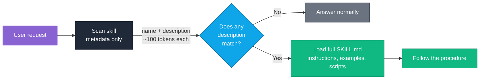

<div align="center">

# ClaudeCode-Skills

### Ready-to-use skills for Claude Code and claude.ai, plus a guide to writing your own

*Skills tell Claude **how** to work. MCP servers decide **what** it can reach. Plugins extend **where** it runs.*

[](LICENSE)
[](#skills-in-this-repo)
[](.github/workflows/validate-skills.yml)
[](CONTRIBUTING.md)

[**Install**](#install) · [**Skills**](#skills-in-this-repo) · [**How skills work**](#how-skills-work) · [**Community picks**](#community-picks) · [**Write a skill**](#write-a-skill-that-actually-fires) · [**Contribute**](CONTRIBUTING.md)

</div>

---

## Install

A skill is a folder with a `SKILL.md` inside. Copy it into a skills directory and Claude picks it
up — no build step, no registry.

```bash
git clone --depth 1 https://github.com/deepaksharma0801/ClaudeCode-Skills.git ~/ClaudeCode-Skills
mkdir -p ~/.claude/skills

# One skill
cp -R ~/ClaudeCode-Skills/skills/development/root-cause-debugging ~/.claude/skills/

# Or all of them
for d in ~/ClaudeCode-Skills/skills/*/*/; do cp -R "${d%/}" ~/.claude/skills/; done
```

| Where | Path | Scope |
|---|---|---|
| Personal | `~/.claude/skills/<name>/SKILL.md` | Every project on your machine |
| Project | `.claude/skills/<name>/SKILL.md` | Committed to a repo, shared with your team |
| claude.ai | Zip the skill folder and upload it in claude.ai's Skills settings | Your claude.ai account |

---

## Skills in this repo

Every skill below is fully written, follows the [template](templates/SKILL_TEMPLATE.md), and passes
[`scripts/validate_skills.py`](scripts/validate_skills.py).

### Development

| Skill | What it does | Reach for it when |
|---|---|---|
| [root-cause-debugging](skills/development/root-cause-debugging/SKILL.md) | Walks a bug backward hop by hop to the line that first created the bad state, and fixes it there | You're tempted to add a null check where the error surfaced |
| [safe-refactor](skills/development/safe-refactor/SKILL.md) | Pins current behavior with tests, then refactors in small steps with the suite green after each | "Clean this up" on code you can't afford to break |
| [commit-message-writer](skills/development/commit-message-writer/SKILL.md) | Writes a commit message from the staged diff in the repo's existing style, and suggests splits | Your history is full of `fix` and `wip` |
| [pr-description-writer](skills/development/pr-description-writer/SKILL.md) | Writes a PR title and description (summary, changes, risk, testing) from the real diff | You're about to open a PR titled "updates" |

### Data & Analysis

| Skill | What it does | Reach for it when |
|---|---|---|
| [csv-data-summarizer](skills/data-and-analysis/csv-data-summarizer/SKILL.md) | Profiles a CSV for types, distributions, nulls, and correlations in one pass | Someone hands you a file and says "what's in this?" |
| [sql-query-reviewer](skills/data-and-analysis/sql-query-reviewer/SKILL.md) | Catches join fan-out, NULL traps, and date-filter bugs, then flags slow patterns | The query runs fine but the numbers look wrong |
| [ab-test-readout](skills/data-and-analysis/ab-test-readout/SKILL.md) | Checks sample ratio and duration, computes lift with confidence intervals, and makes a ship call | "Did the variant win?" |

### Security & QA

| Skill | What it does | Reach for it when |
|---|---|---|
| [secrets-precommit-check](skills/security-and-qa/secrets-precommit-check/SKILL.md) | Scans staged changes for keys, tokens, private keys, and `.env` files, and blocks the commit | You're about to push to a public repo |
| [dependency-audit](skills/security-and-qa/dependency-audit/SKILL.md) | Runs the right audit tool per ecosystem and triages results into ranked upgrade commands | Before a launch, or when scanner output is 200 lines long |
| [threat-model-lite](skills/security-and-qa/threat-model-lite/SKILL.md) | One-page STRIDE model: data flow, trust boundaries, ranked threats, concrete mitigations | A feature touches auth, user data, payments, or uploads |
| [test-plan-writer](skills/security-and-qa/test-plan-writer/SKILL.md) | Risk-based test plan with level, inputs, and priority per case, then writes the P1 tests | "What should I test for this?" |

### Business & Communication

| Skill | What it does | Reach for it when |
|---|---|---|
| [weekly-status-update](skills/business-and-comms/weekly-status-update/SKILL.md) | Turns git history or notes into an outcome-first update with blockers and next steps | Your manager wants an update and all you have is `git log` |
| [meeting-notes-to-actions](skills/business-and-comms/meeting-notes-to-actions/SKILL.md) | Extracts decisions, owned and dated action items, and open questions from a transcript | The call ended and nobody wrote down who's doing what |

---

## How skills work

Claude doesn't read your whole skill library every turn. It sees only each skill's `name` and
`description`, and loads the full `SKILL.md` for the one that matches the request.



**That makes the `description` the most important line in a skill.** A brilliant skill with a vague
description never runs.

### Skills vs MCP servers vs plugins

| | **Skills** | **MCP servers** | **Plugins** |
|---|---|---|---|
| **Answers** | *How* should Claude do this? | *What* can Claude reach? | *Where* does Claude run? |
| **Format** | `SKILL.md` + frontmatter | A running process (stdio/HTTP) | CLI package |
| **Gives you** | Procedure, standards, taste | Data, APIs, side effects | Commands, hooks, bundled tools |
| **Loads** | On demand, when relevant | At session start | At install time |
| **Lives in** | [`skills/`](skills) | [`mcp-servers/`](mcp-servers) | [`claude-code-plugins/`](claude-code-plugins) |

> [!TIP]
> Reach for a **skill** when Claude *can* already do the task but does it inconsistently. Reach for
> an **MCP server** when Claude simply cannot see the thing you're talking about.

---

## Community picks

Skills and collections maintained elsewhere. Each keeps its own license.

### Skills

| Skill | Source | What it does |
|---|---|---|
| [web-artifacts-builder](https://github.com/anthropics/skills/tree/main/skills/web-artifacts-builder) | anthropics/skills | Builds multi-component claude.ai artifacts with React, Tailwind, and shadcn/ui |
| [mcp-builder](https://github.com/anthropics/skills/tree/main/skills/mcp-builder) | anthropics/skills | Guided workflow for building MCP servers around external APIs |
| [brand-guidelines](https://github.com/anthropics/skills/tree/main/skills/brand-guidelines) | anthropics/skills | Applies brand colors, fonts, and typography to artifacts |
| [internal-comms](https://github.com/anthropics/skills/tree/main/skills/internal-comms) | anthropics/skills | Drafts newsletters, status reports, and FAQs in a house format |
| [systematic-debugging](https://github.com/obra/superpowers/tree/main/skills/systematic-debugging) | obra/superpowers | Four-phase debugging process, including backward root-cause tracing |
| [test-fixing](https://github.com/mhattingpete/claude-skills-marketplace/tree/main/engineering-workflow-plugin/skills/test-fixing) | mhattingpete/claude-skills-marketplace | Finds failing tests and proposes fixes |
| [ios-simulator-skill](https://github.com/conorluddy/ios-simulator-skill) | conorluddy | Drives the iOS Simulator, preferring accessibility APIs over screenshots |

### Collections

| Repository | Why it's worth a look |
|---|---|
| [anthropics/skills](https://github.com/anthropics/skills) | The official spec, the document skills (`docx`, `pdf`, `pptx`, `xlsx`), and reference examples. When a blog post and the spec disagree, this wins. |
| [ComposioHQ/awesome-claude-skills](https://github.com/ComposioHQ/awesome-claude-skills) | Large directory of practical skills, plus app integrations through Composio |
| [travisvn/awesome-claude-skills](https://github.com/travisvn/awesome-claude-skills) | Well-written notes on progressive disclosure and how to vet a skill before trusting it |
| [GetBindu/awesome-claude-code-and-skills](https://github.com/GetBindu/awesome-claude-code-and-skills) | Hundreds of skills, persona skills, and expert agents |
| [ai-for-developers/awesome-claude](https://github.com/ai-for-developers/awesome-claude) | SDKs, agent frameworks, and prompt architectures beyond skills |

### MCP servers

| Server | Capability | Notes |
|---|---|---|
| [`server-postgres`](https://github.com/modelcontextprotocol/servers) | Read-only SQL and schema inspection | A safe default for pointing an agent at production |
| [`server-memory`](https://github.com/modelcontextprotocol/servers) | Knowledge-graph memory | State that survives across sessions |
| [`server-github`](https://github.com/modelcontextprotocol/servers) | Repos, issues, PRs | Official integration |
| [`exa-mcp-server`](https://github.com/exa-labs/exa-mcp-server) | Real-time web search | Needs `EXA_API_KEY` |

More: [win4r/Awesome-Claude-MCP-Servers](https://github.com/win4r/Awesome-Claude-MCP-Servers) ·
config examples in [`mcp-servers/`](mcp-servers).

> [!WARNING]
> An MCP server runs with whatever credentials you give it. Scope the database user, prefer
> read-only, and keep keys in environment variables (`"${DATABASE_URL}"`), never in a committed config.

---

## Write a skill that actually fires

Start from [`templates/SKILL_TEMPLATE.md`](templates/SKILL_TEMPLATE.md):

```markdown
---
name: your-skill-name          # kebab-case, same as the folder
description: What it does, and exactly when Claude should use it. Max 200 characters.
dependencies: python>=3.8      # optional
---

# Detailed Instructions
## Overview
## Workflow Rules
## Anti-Patterns (What NOT to do)
## Examples
```

### The description is the trigger

| | Description | Result |
|---|---|---|
| Bad | `A powerful skill for working with data.` | Never fires — matches everything, so it means nothing |
| Bad | `Data analysis helper.` | Never fires — names a category, not a condition |
| Good | `Profiles a CSV for column types, distributions, missing data, and correlations. Use when a user shares a tabular file or asks for a data profile.` | Fires reliably — says what it does **and** when |

### The body

- **Workflow Rules:** numbered, imperative steps. Directives, not prose.
- **Anti-Patterns:** the mistakes Claude makes without the skill. Skip this and the skill fails in
  the field, however good the rest is.
- **Examples:** a real request and the exact output you expect. This is what Claude imitates.

Check your skill before opening a PR:

```bash
python3 scripts/validate_skills.py
```

---

## Repository layout

```text
ClaudeCode-Skills/
├── skills/                      # procedural knowledge — one folder per skill
│   ├── development/
│   ├── data-and-analysis/
│   ├── business-and-comms/
│   └── security-and-qa/
├── mcp-servers/                 # MCP config examples
├── claude-code-plugins/         # plugin notes
├── templates/SKILL_TEMPLATE.md  # start every skill here
├── scripts/validate_skills.py   # checks every SKILL.md (runs in CI)
└── CONTRIBUTING.md
```

---

## Contributing

Two kinds of PR are welcome: **a link** for the community lists, or **a new skill** under
`skills/<category>/`. The `description` gets the most review — it decides whether the skill is ever
used. See [CONTRIBUTING.md](CONTRIBUTING.md) for the checklist and the
[Code of Conduct](CODE_OF_CONDUCT.md).

---

<div align="center">

Released under [CC0 1.0](LICENSE) — public domain. Linked projects keep their own licenses.

**[Back to top](#claudecode-skills)**

</div>
